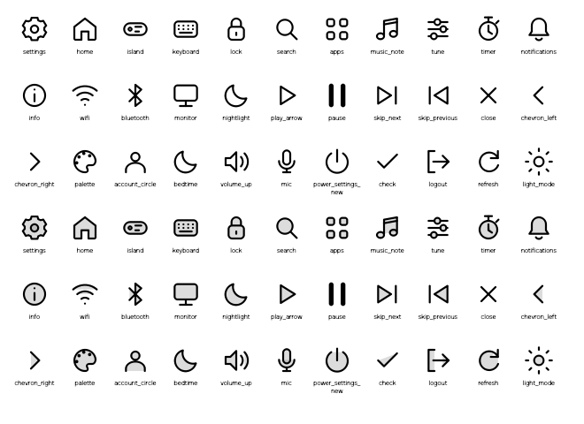

# Tahow

A modular Quickshell desktop shell with an island, command palette, settings, and glass lock visuals. Tahow runs from its own entry point and includes optional Ryoku companions for Ryostore.

This is early software. Runtime testing has been performed on **Hyprland**. The host boundary uses Wayland protocols where available; **niri has not been validated**.

## What it includes

- An island with simulated glass while collapsed and snapshot refraction when expanded by click or hover.
- A command palette and settings that follow the general dark/light appearance and desktop accent.
- General preferences with separate island, palette, and lockscreen overrides.
- A Glass settings section with live preview, numeric sliders and per-component overrides.
- English (`en-US`) and Brazilian Portuguese (`pt-BR`) translations, with automatic locale selection using the Ryoku default when hosted.
- 66 original SVG glyphs: 33 symbols in two variants.
- Optional Ryoku launcher and lockscreen companions. The hosted lock keeps qylock's PAM and fingerprint authentication.



## Run

Install Quickshell and its Qt/QML dependencies through your distribution. A Wayland desktop is required; desktop services and screen capture depend on the host and its available protocols. From this repository:

```sh
qs -p "$PWD/shell/shell.qml"
```

Ryoku integration sources live in `integrations/ryostore/launcher` and `integrations/ryostore/lockscreen`. Export a reviewable catalogue checkout with:

```sh
bun tools/export-ryostore.ts --to /path/to/ryostore
```

The existing `tahoe-shell` installation IDs and IPC names are retained for compatibility. The project name is Tahow, and the preferences home is `~/.config/tahow-shell` (the legacy `~/.config/tahoe-shell` directory is still read as a fallback). See [shell/README.md](shell/README.md) for preferences and IPC.

Exporting retires the old `launchers/tahoe` listing while preserving its files for existing installation receipts. See the [Ryoku catalogue and configuration contract](integrations/ryoku/README.md) for the launcher settings declaration, the Glass configuration entry point, and compatibility with the Hub's filtered Subshells page.

## Glass behavior

Expanded surfaces acquire frozen desktop snapshots while excluding their own surfaces. Capture happens before the opening animation. These textures do not update when windows move behind an open surface. Capture availability depends on the compositor/provider; fallback rendering is used when capture is disabled or unavailable. The collapsed island does not take screenshots or run the refraction shader.

Glass shares one neutral light/dark base and accent mixing policy across the island, palette, and lock password field. Palette and island apply the same `glassOpacity` intensity; component overrides still take precedence over General. The lock field intentionally keeps its separate, lower `lockTint` intensity so the wallpaper remains visible through the small input. Its field optics (`lockIor`, `lockDispersion`, etc.) remain independent. Chromatic dispersion defaults to `0.08` and can be overridden per component; it adds colored refraction at the lens edges without animating RGB channels. The palette and island share the same lens settings unless component overrides are set; the collapsed island keeps its simulated glass treatment.

## Development

Seven independent desktop widgets are available as Ryoku plugins: CPU,
temperature, disk, memory, session controls, clock and media. They use Tahow's
simulated-glass cards and do not require either subshell to run. See the
[widget sources and installation guide](integrations/widgets/README.md).

Use **Bun** for scripts and dependencies:

```sh
bun run check
bun test
bun tools/build-shaders.ts
bun tools/sync-i18n.ts
```

The shell is divided into configuration, theme, runtime, and host adapters. `shell/shell.qml` is the independent entry point; only the Ryoku adapter owns the host integration. Shader sources and their compiled `.qsb` artifacts are kept together.

Read [CONTRIBUTING.md](CONTRIBUTING.md), [AGENTS.md](AGENTS.md), and [SECURITY.md](SECURITY.md) before changing authentication, capture, or integration behavior. Automated lock tests use simulated authentication; successful real lock/unlock is a separate manual check on the target machine.

## License and attribution

Tahow is distributed under [AGPL-3.0](LICENSE), with upstream license notices retained. DynamicIsland contributed MIT-licensed source; Ryoku supplied glass components. See [NOTICE.md](NOTICE.md) and [source provenance](shell/PROVENANCE.txt). Original icons are not copied or traced from Apple or Icons8. No Apple artwork or proprietary fonts are bundled.
