<div align="center">

# Tahow


**Your desktop, through glass.**

A modular shell for Quickshell and Wayland.

[Documentation](https://tahow.eduardoaugusto.work/en-US/) · [Português](https://tahow.eduardoaugusto.work/pt-BR/) · [Getting started](https://tahow.eduardoaugusto.work/en-US/getting-started/) · [Showcase](#showcase)

[](https://github.com/eduardoaugustolb/Tahow/actions/workflows/docs.yml)
[](LICENSE)

</div>

---

A modular Quickshell desktop shell with an island, Spotlight, settings, and glass lock visuals. Tahow runs from its own entry point and includes optional Ryoku companions for Ryostore.

This is early software. Runtime testing has been performed on **Hyprland**. The host boundary uses Wayland protocols where available; **niri has not been validated**.

## Showcase

[Full gallery in the documentation](https://tahow.eduardoaugusto.work/en-US/showcase/) · [Galeria em português](https://tahow.eduardoaugusto.work/pt-BR/showcase/)

Captured on Hyprland at 1920 × 1080 with the author's current wallpaper, desktop accent and Brazilian Portuguese interface. Click an image for the full-size capture. Media uses live Spotify/MPRIS data, including album artwork. The widget gallery and hover preview are isolated source renders with live data; notifications use demonstration fixtures. The lockscreen is a visual preview with simulated authentication.

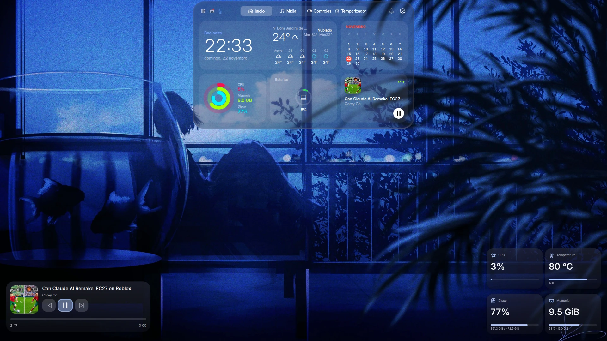

| Collapsed island and desktop | Spotlight |
| --- | --- |
| 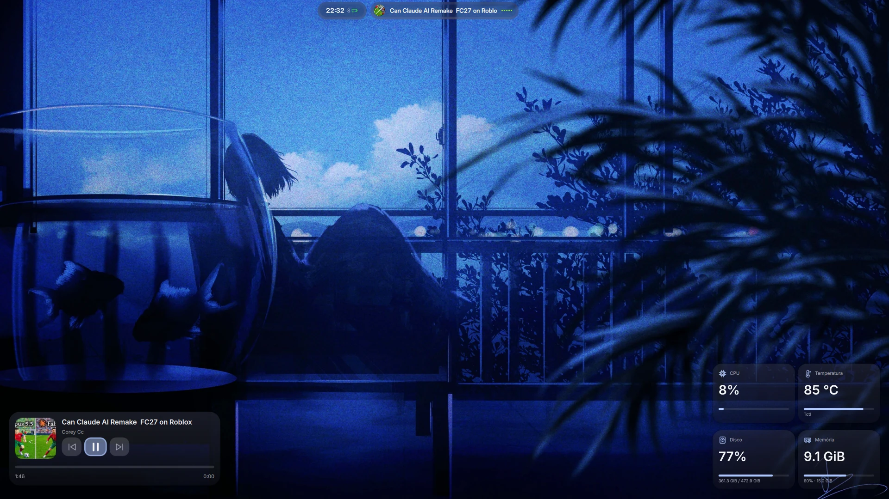 | 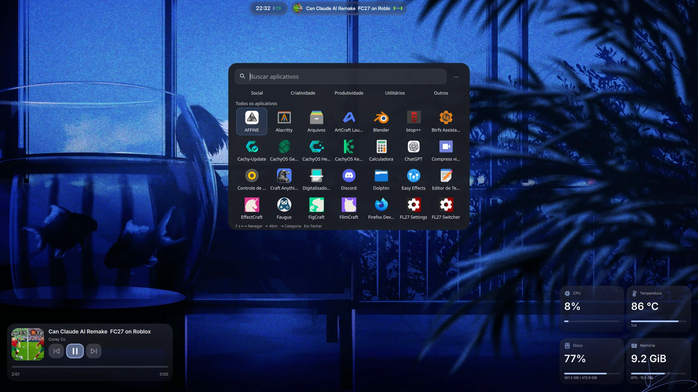 |

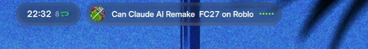

| Media | Quick controls |
| --- | --- |
| 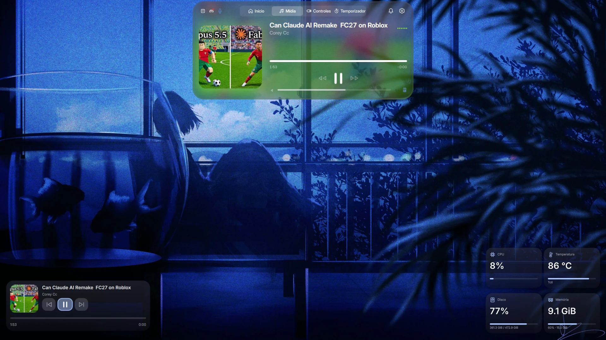 | 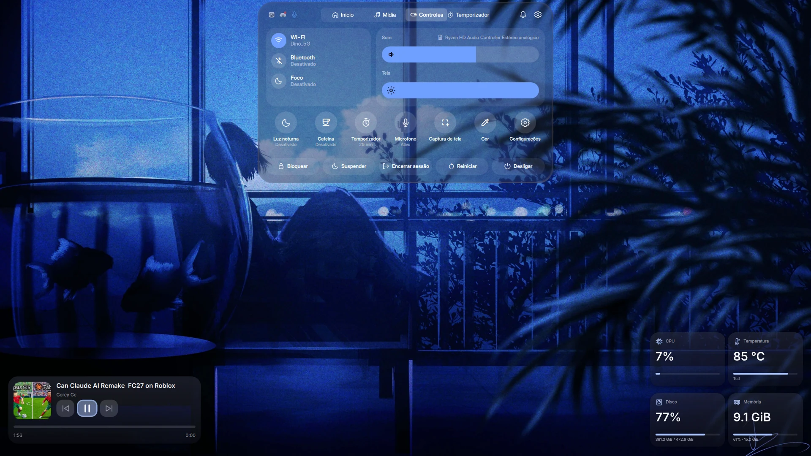 |

| Timer and stopwatch | Notification center |
| --- | --- |
| 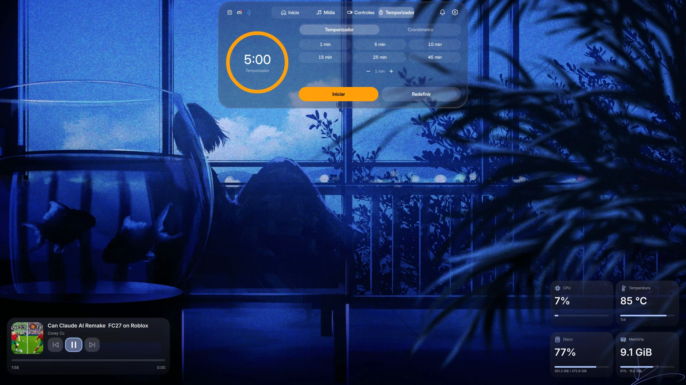 | 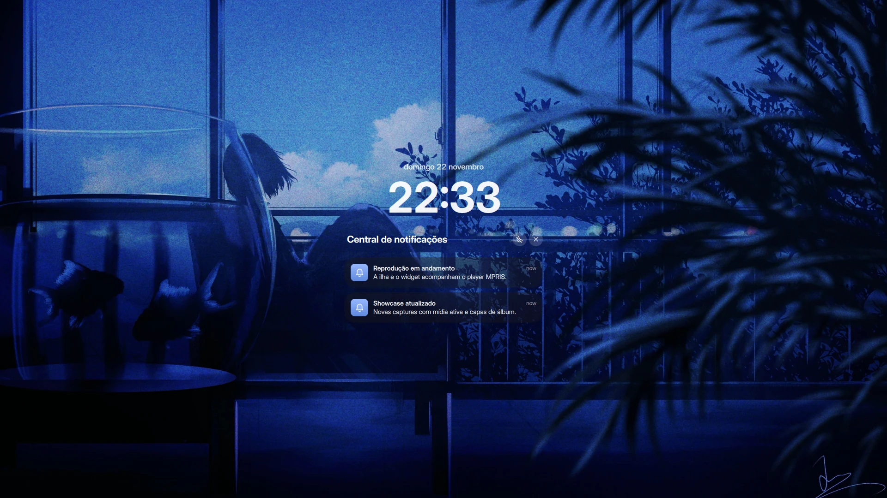 |

| Appearance, language and motion | Glass controls and material preview |
| --- | --- |
| 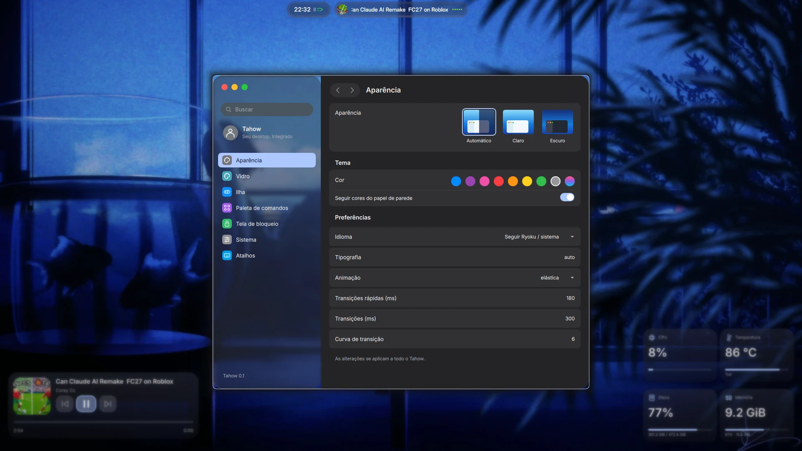 | 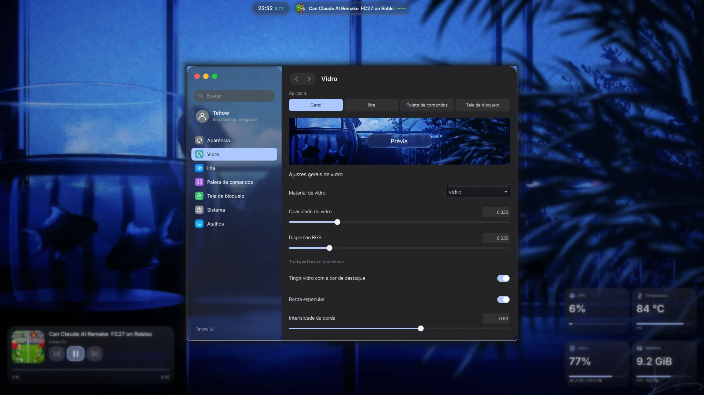 |

<details>
<summary>All component settings</summary>

| Island overrides | Spotlight overrides |
| --- | --- |
| 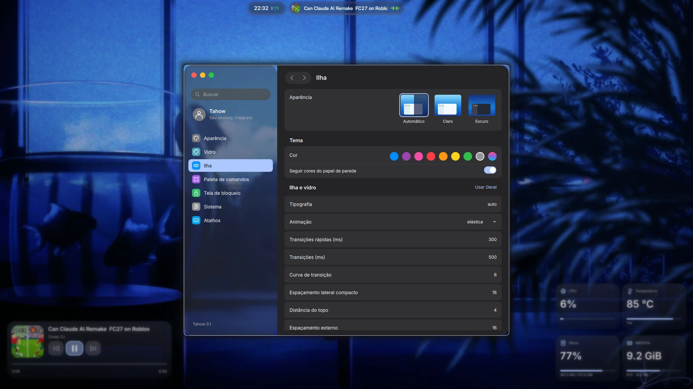 | 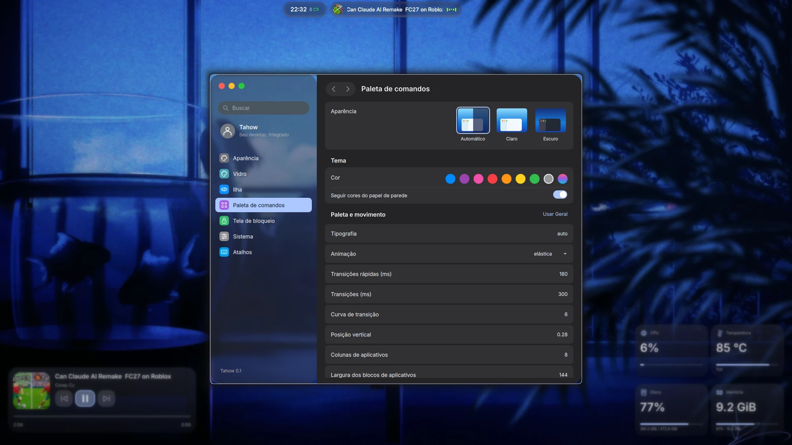 |

| Lockscreen overrides | System preferences |
| --- | --- |
| 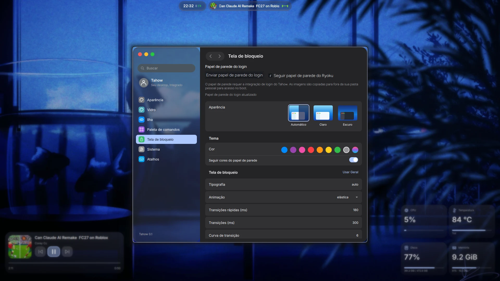 | 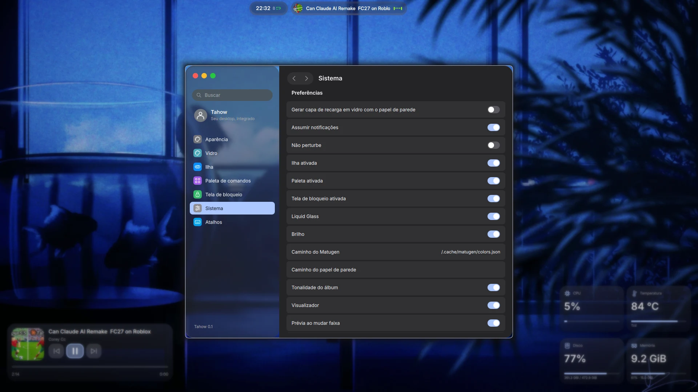 |

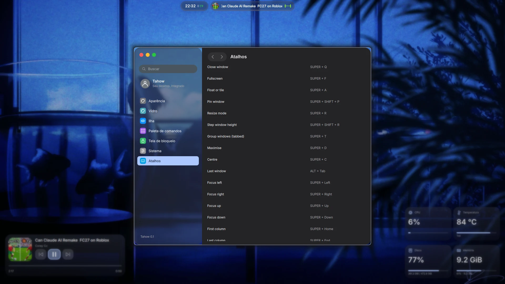

</details>

**Desktop widgets** — CPU, temperature, disk, memory, session controls, clock, media and GitHub contributions, shown together in a temporary preview layout with the Liquid Glass material.

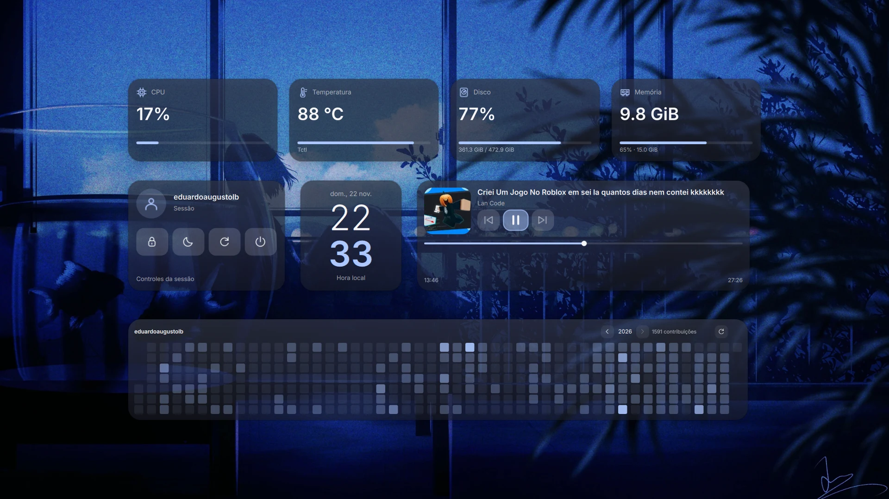

**Lockscreen** — glass clock and password field over the same wallpaper.

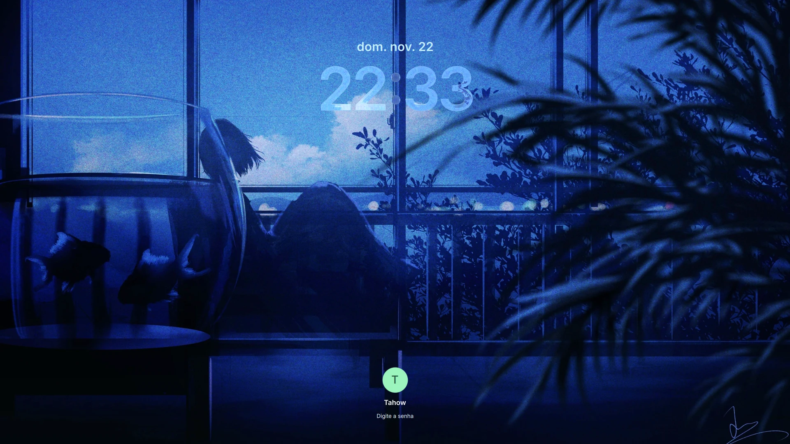

Capture details and wallpaper provenance: [showcase notes](docs/showcase/README.md).

**Animated reload cover** — an original Tahow glass wallpaper with connected
Sacramento lettering. Traveling flow deforms the background and letter contours,
with moving refraction and highlights in a seamless four-second loop.

[](docs/showcase/reload-cover.mp4)

[Full-resolution MP4](docs/showcase/reload-cover.mp4) · [Rendering and integration notes](docs/reload-cover.md)

## What it includes

- An island with optional compositor-live refraction across collapsed, preview and expanded states, with snapshot or simulated fallback.
- Spotlight and settings that follow the general dark/light appearance and desktop accent.
- General preferences with separate island, palette, and lockscreen overrides.
- A Glass settings section with live preview, numeric sliders and per-component overrides.
- English (`en-US`) and Brazilian Portuguese (`pt-BR`) translations, with automatic locale selection using the Ryoku default when hosted.
- 66 original SVG glyphs: 33 symbols in two variants.
- Optional Ryoku launcher and lockscreen companions. The hosted lock keeps qylock's PAM and fingerprint authentication.

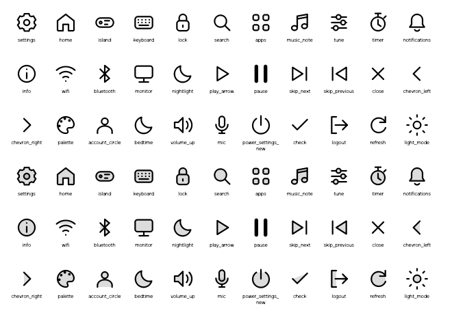

## Run

Install Quickshell and its Qt/QML dependencies through your distribution. A Wayland desktop is required; desktop services and screen capture depend on the host and its available protocols. From this repository:

```sh
sh "$PWD/shell/bin/start-shell.sh"
```

The launcher starts Quickshell detached (`--daemonize`) and idempotently (`--no-duplicate`), so closing the terminal or typing `exit` does not kill the bar. Plain `qs -p ... &` would leave it in the terminal's job table and a second `exit` would send it SIGHUP.

Ryoku integration sources live in `integrations/ryostore/launcher` and `integrations/ryostore/lockscreen`. Export a reviewable catalogue checkout with:

```sh
bun tools/export-ryostore.ts --to /path/to/ryostore
```

The existing `tahoe-shell` installation IDs and IPC names are retained for compatibility. The project name is Tahow, and the preferences home is `~/.config/tahow-shell` (the legacy `~/.config/tahoe-shell` directory is still read as a fallback). See [shell/README.md](shell/README.md) for preferences and IPC.

Exporting retires the old `launchers/tahoe` listing while preserving its files for existing installation receipts. See the [Ryoku catalogue and configuration contract](integrations/ryoku/README.md) for the launcher settings declaration, the Glass configuration entry point, and compatibility with the Hub's filtered Subshells page.

## Glass behavior

The optional [Hyprland compositor provider](native/live-glass/README.md) refracts the real scene below each owning Wayland surface and updates from compositor damage. It renders the material before the Tahow surface, without wallpaper stand-ins or a continuous screen-capture loop. The source can include applications drawn below that surface; sibling elements flattened into the same QML surface cannot refract one another.

Live refraction requires the matching native plugin and supported Hyprland OpenGL backend. Without it, the island shares a clean frozen desktop snapshot across collapsed, preview and expanded states; palette and settings retain their own snapshot lifecycles. These fallback textures do not follow moving windows. Simulated material is used when capture is disabled or unavailable. If the provider arrives after startup, the island releases its startup snapshot only after all visible Glass consumers have ready native replacements.

Glass shares one neutral light/dark base and accent mixing policy across the island, palette, and lock password field. Palette and island apply the same `glassOpacity` intensity; component overrides still take precedence over General. The lock field intentionally keeps its separate, lower `lockTint` intensity so the wallpaper remains visible through the small input. Its field optics (`lockIor`, `lockDispersion`, etc.) remain independent. Chromatic dispersion defaults to `0.08` and can be overridden per component; it adds colored refraction at the lens edges without animating RGB channels. The palette and island share the same lens settings unless component overrides are set. The native provider maps lens preferences to Hyprland acrylic, whose optical response differs from the QSB snapshot fallback; compositor blur defaults still apply. The lockscreen keeps its separate visual pipeline.

## Development

Eight independent desktop widgets are available as Ryoku plugins: CPU,
temperature, disk, memory, session controls, clock, media and GitHub contributions. They use Tahow's
simulated-glass cards by default, offer optional native compositor Liquid Glass, and do not require either subshell to run. See the
[widget sources and installation guide](integrations/widgets/README.md).

Use **Bun** for scripts and dependencies:

```sh
bun run check
bun test
bun tools/build-shaders.ts
bun tools/sync-i18n.ts
```

The shell is divided into configuration, theme, runtime, and host adapters. `shell/shell.qml` is the independent entry point; only the Ryoku adapter owns the host integration. Shader sources and their compiled `.qsb` artifacts are kept together.

Read [CONTRIBUTING.md](CONTRIBUTING.md), [AGENTS.md](AGENTS.md), and [SECURITY.md](SECURITY.md) before changing authentication, capture, or integration behavior. Automated lock tests use simulated authentication; successful real lock/unlock is a separate manual check on the target machine.

## License and attribution

Tahow is distributed under [AGPL-3.0](LICENSE), with upstream license notices retained. DynamicIsland contributed MIT-licensed source; Ryoku supplied glass components. See [NOTICE.md](NOTICE.md) and [source provenance](shell/PROVENANCE.txt). Original icons are not copied or traced from Apple or Icons8. No Apple artwork or proprietary fonts are bundled.

## Web documentation

The bilingual MDX documentation uses the shell's visual language and is configured for [GitHub Pages](https://tahow.eduardoaugusto.work/). Run `bun install --frozen-lockfile` and `bun run docs:dev` for local development, or `bun run docs:build` for a static build. See [website/README.md](website/README.md) for publishing and visual provenance.
